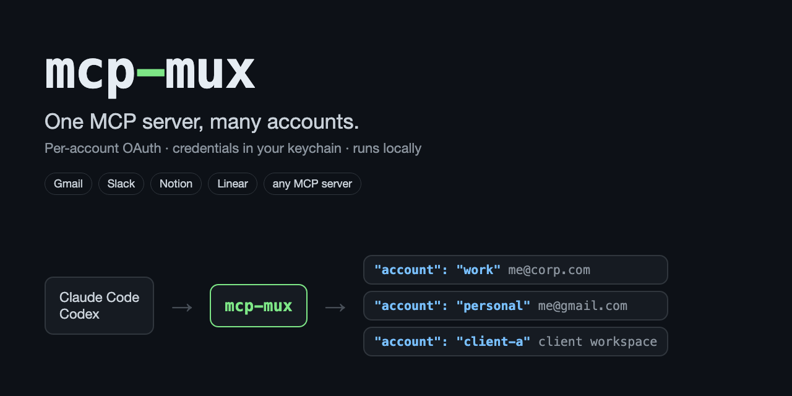

# mcp-mux: multiple accounts for any MCP server

[](https://github.com/majiayu000/mcp-mux/actions/workflows/ci.yml)
[](LICENSE)
[](https://bun.sh)
[](https://modelcontextprotocol.io)

**mcp-mux lets Claude Code and Codex use multiple accounts of the same MCP server at once: two Gmail inboxes, a work and a client Slack, several Notion or Linear workspaces.** It runs as one local MCP server. Every tool gets a required `account` argument, each account signs in with its own OAuth session, and tokens are kept in the macOS Keychain.



Today, Claude connectors take one account per connector ([anthropics/claude-code#27302](https://github.com/anthropics/claude-code/issues/27302), 422 👍, no official answer). Slack takes one workspace ([#44243](https://github.com/anthropics/claude-code/issues/44243)). Codex added multiple accounts only for Gmail, Calendar and Contacts ([openai/codex#20500](https://github.com/openai/codex/issues/20500)). mcp-mux works with any MCP server you can run or reach locally.

## Quick start

```sh
bun add -g mcp-mux        # needs Bun ≥ 1.3 (npm i -g mcp-mux also works; the CLI runs on Bun)
```

Write `notion.mux.json`. Accounts share the upstream and override only what differs:

```json
{
  "name": "notion",
  "upstream": { "url": "https://mcp.notion.com/mcp", "oauth": {} },
  "accounts": {
    "work":     { "description": "Acme workspace", "oauth": { "authorizeParams": { "login_hint": "me@acme.com" } } },
    "personal": { "description": "personal notes" }
  }
}
```

Sign in each account once, check them, and add the server to your client:

```sh
mcp-mux login notion.mux.json work
mcp-mux login notion.mux.json personal
mcp-mux status notion.mux.json

claude mcp add notion -- mcp-mux serve /abs/path/notion.mux.json     # Claude Code
codex mcp add notion -- mcp-mux serve /abs/path/notion.mux.json      # Codex
```

The model now sees each Notion tool once, with `account: "work" | "personal"` required.

## What it looks like

This run uses the bundled mock OAuth server (`examples/mock-oauth-server.ts`): two fake users behind one URL, told apart only by their tokens, the same way Gmail or Notion work.

```text
$ mcp-mux login mail.mux.json work
[mcp-mux] logged in "work" (2 tools available)
$ mcp-mux login mail.mux.json home
[mcp-mux] logged in "home" (2 tools available)
$ mcp-mux status mail.mux.json
work    ok (2 tools)    http: http://127.0.0.1:47821/mcp
home    ok (2 tools)    http: http://127.0.0.1:47821/mcp

# what the client sees after `mcp-mux serve mail.mux.json`
tools: whoami, search_mail
account: {"type":"string","enum":["work","home"],"description":"Which account to use: work (alice@work.example), home (alice@home.example)"}
whoami({"account":"work"})                    -> alice@work.example
whoami({"account":"home"})                    -> alice@home.example
search_mail({"account":"work","query":"e"})   -> ["Q3 budget review moved to Friday","Invoice #4411 from Acme"]
search_mail({"account":"home","query":"e"})   -> ["Dentist appointment reminder","Your library books are due"]
whoami({"account":"nope"})                    -> error -32602: unknown account "nope"; expected one of: work, home
```

The same flow ran in Claude Code: `claude mcp list` reported `✔ Connected` for both a filesystem mux and this OAuth mux.

## Features

- **One toolset, many accounts.** The client lists each upstream tool once, with a required `account` enum. Optional `description` labels (an email address, a workspace name) are shown to the model next to each account.
- **Fails closed.** A missing or unknown account is an error. A logged-out account returns an error naming the `mcp-mux login` command to run. mcp-mux never falls back to another account or returns an empty result in its place.
- **Per-account OAuth 2.1** for remote servers: protected resource discovery, dynamic client registration or a pre-registered client, PKCE, RFC 8707 `resource`, RFC 9207 `iss` check, and automatic refresh. `authorizeParams` pins a login to one identity, for example Google `login_hint` or Slack `team`.
- **Isolated credentials.** Each account gets its own Keychain entry (`mcp-mux` / `<name>/<account>`), or an AES-256-GCM encrypted file on other platforms. A stdio account sees only its own environment variables, never another account's secrets.
- **Self-healing.** If an upstream crashes, or you log an account in while the client is running, the next call reconnects. No client restart needed.
- **stdio and Streamable HTTP upstreams**, with `${ENV}` expansion that fails loudly when a variable is unset.

## Compared with

| | mcp-mux | [mcp-multiauth](https://github.com/TuchSoft/mcp-multiauth) | [mcp-remote](https://github.com/geelen/mcp-remote) ×N | Claude Code natively | Codex natively |
|---|---|---|---|---|---|
| One toolset + `account` argument | ✅ | ✅ | ✗ tools duplicated per account | ✗ one server per account | ✗ |
| Per-account OAuth login | ✅ | ✗ static headers / env only | ✅ | ◐ one login per endpoint | ◐ Gmail / Calendar / Contacts only |
| Pin the identity at login (`login_hint`, `team`) | ✅ | ✗ | ✅ | ✗ | ✗ |
| Encrypted or keychain token storage | ✅ | ✗ | ✗ not documented | ✅ | cloud |
| stdio upstreams | ✅ | ✅ | ✗ | ✅ | ✅ |
| Live check of every account | ✅ `status` | ✗ | ◐ one server | ◐ `claude mcp list` | ✗ |

Full comparison, including the self-hosted gateways: [docs/comparison.md](docs/comparison.md).

## Configuration

One file describes one upstream server and its accounts. `upstream` is shared by all accounts, and each account overrides only what differs. `env`, `headers`, `oauth` and `oauth.authorizeParams` are merged one level deep.

Local (stdio) server, where each account gets different arguments or environment variables:

```json
{
  "name": "fs",
  "upstream": { "command": "npx", "args": ["-y", "@modelcontextprotocol/server-filesystem"] },
  "accounts": {
    "work":     { "args": ["-y", "@modelcontextprotocol/server-filesystem", "${MUX_WORK_DIR}"] },
    "personal": { "args": ["-y", "@modelcontextprotocol/server-filesystem", "${MUX_PERSONAL_DIR}"],
                  "env": { "API_TOKEN": "${PERSONAL_TOKEN}" } }
  }
}
```

| Field | Meaning |
|---|---|
| `name` | Server name, also the credential key prefix. `[A-Za-z0-9_-]`. |
| `upstream.command` / `args` / `env` / `cwd` | stdio upstream. |
| `upstream.url` / `headers` | Streamable HTTP upstream. |
| `upstream.oauth` | Present means the upstream uses OAuth. Optional `clientId`, `clientSecret`, `scope`, `callbackPort`, `authorizeParams`. |
| `accounts.<name>` | Same fields as `upstream`, plus `description` (shown to the model). |
| `store` | `{"type":"keychain","keychain":"<path>"}` or `{"type":"file","path":"<path>"}`. The default is the login keychain on macOS, and `~/.config/mcp-mux/credentials.json` elsewhere. |

Some servers don't support dynamic client registration; Slack is one. For those, register an OAuth app yourself and set `oauth.clientId`, `oauth.clientSecret`, and a fixed `oauth.callbackPort` whose redirect URI `http://127.0.0.1:<port>/callback` is registered with the app.

Secrets: `${VAR}` is read from mcp-mux's own environment. MCP clients start servers with only the variables you configure, so put secrets (and `MCP_MUX_STORE_KEY` when using the file store) in the client's `env` for this server, for example `claude mcp add notion -e MCP_MUX_STORE_KEY=... -- mcp-mux serve ...`.

### Client config files

Claude Code `.mcp.json`:

```json
{ "mcpServers": { "notion": { "command": "mcp-mux", "args": ["serve", "/abs/path/notion.mux.json"] } } }
```

Codex `~/.codex/config.toml`:

```toml
[mcp_servers.notion]
command = "mcp-mux"
args = ["serve", "/abs/path/notion.mux.json"]
```

## Commands

```text
mcp-mux serve  <config.json>                          run as a stdio MCP server
mcp-mux login  <config.json> <account> [--no-browser] OAuth login for one account
mcp-mux logout <config.json> <account>                delete one account's stored credentials
mcp-mux status <config.json>                          connect to every account and report; exit 1 if any fails
```

## Try it without real accounts

```sh
git clone https://github.com/majiayu000/mcp-mux && cd mcp-mux && bun install
bun examples/mock-oauth-server.ts                          # http://127.0.0.1:47821/mcp
bun src/cli.ts login examples/mock-mail.mux.json work      # login_hint pins alice@work.example
bun src/cli.ts login examples/mock-mail.mux.json home      # pick alice@home.example on the consent page
claude mcp add mail -- bun "$PWD/src/cli.ts" serve "$PWD/examples/mock-mail.mux.json"
```

## Limitations

- **OAuth has only been tested against the bundled mock provider**, not real Gmail, Slack or Notion. Reports from real providers are welcome.
- Local clients only: Claude Code, Codex, Claude Desktop. claude.ai on the web, the mobile apps and cloud routines connect only to remote URLs.
- Only tools are proxied. Resources, prompts and `tools/list_changed` aren't passed through yet.
- All accounts must expose the same tools. mcp-mux refuses to start otherwise and lists the difference.
- The MCP TypeScript SDK supports protocol versions up to 2025-11-25. Upstreams that only speak 2026-07-28 won't connect yet.

## Development

```sh
bun install
bun test           # config, stores (incl. a throwaway macOS keychain), real filesystem server, OAuth end to end
bun run typecheck
```

Design and research notes: [docs/design.md](docs/design.md), [docs/research.md](docs/research.md), [docs/comparison.md](docs/comparison.md).

## License

MIT
